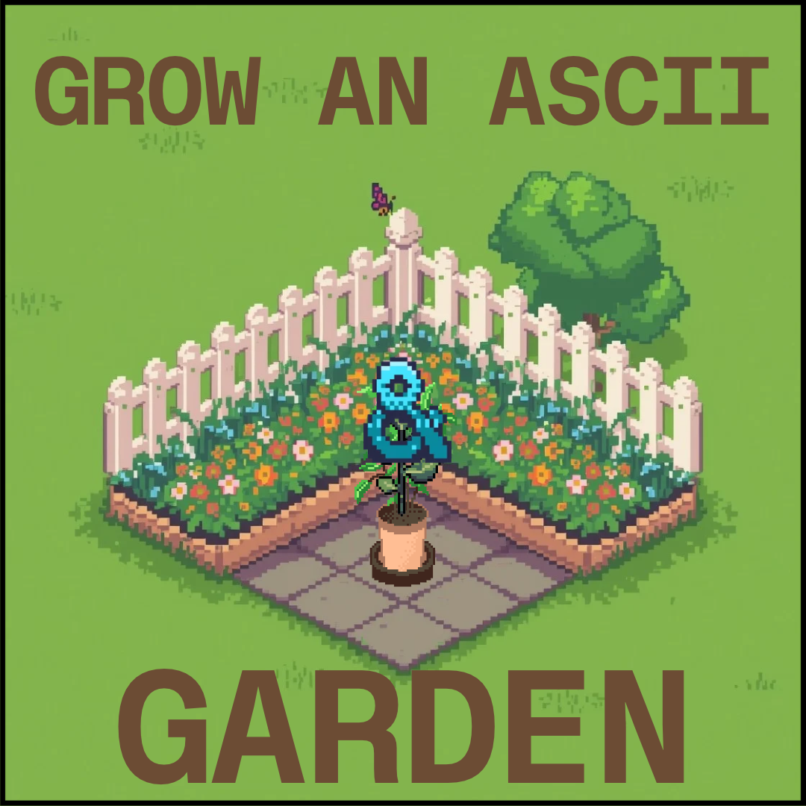

# Final Project: ASCII Garden

[](../AI-USAGE.md)

## Overview

ASCII Garden is a persistent digital garden where characters grow from NUL to ASCII 127 as real days pass. Users plant, water, shovel, and harvest characters, then keep harvested results in a flower-themed collection.

## Setup and installation

Requirements: Git, Node.js 20+, and Docker Desktop with Compose.

```bash
git clone https://github.com/abunjingbunjing/Digital-Garden.git
cd Digital-Garden
```

Create root `.env`:

```env
POSTGRES_PASSWORD=devpassword
CORS_ORIGINS=http://localhost:5173
SESSION_SECRET=replace-with-a-long-random-value
```

Start the database and API:

```powershell
docker compose up -d --build
```

The database schema runs when the volume is first created. Seed the developer garden with:

```powershell
Get-Content .\server\db\seed.sql | docker compose exec -T db psql -U postgres -d haunted
```

Set `client/.env`:

```env
VITE_USE_MOCK_API=false
VITE_API_BASE_URL=http://localhost:3000
```

Install and run the client:

```powershell
cd client
npm install
npm run dev
```

Open `http://localhost:5173`. Developer account: `dev` / `garden123`.

## Features and usage

Plant starts every new slot at NUL. Water advances one character and uses one of three daily charges. Shovel opens an in-page confirmation before removal. Harvest moves a developed character to the collection. Characters grow over 128 days, and beds unlock at 30, 60, 90, and 120.

API endpoints: `GET /healthz`, `GET /readyz`, `POST /api/auth/signup`, `POST /api/auth/login`, `GET /api/garden`, and `PUT /api/garden`. Garden routes require a Bearer session token.

## Project structure

- `client/`: React/Vite interface, API adapters, and styles.
- `server/`: Express API and PostgreSQL connection.
- `server/db/`: schema and developer seed.
- `compose.yml`: local database and API services.
- `docs/`: planning and submission records.
- `docs/screenshots/`: interface screenshots.

## Screenshots




## Known issues and next steps

Local build, Docker readiness, protected-route checks, and dependency audits pass. Public deployment, final contrast review, and presentation assets remain. Keep `SESSION_SECRET` private. Mock mode is for local interface testing only.

## Presentation

- Video: not recorded yet
- Slides: not prepared yet
- Square image: `docs/screenshots/ascii-garden-square.png.png`

AI disclosure: [AI-USAGE.md](../AI-USAGE.md). Flower graphics use [Twemoji](https://github.com/twitter/twemoji), CC-BY 4.0.
